# AnimeAV TV

Cliente no oficial de **animeav1.com** para **Android TV / Google TV**, escrito en Kotlin con Jetpack Compose y Media3 (ExoPlayer).

La app **no aloja ningún archivo de vídeo ni audio**. Todo el catálogo, las imágenes, los metadatos y los streams se obtienen en tiempo real de animeav1.com y de sus servidores de vídeo de terceros.

---

## Características

- Interfaz de TV con navegación por D-pad y estados de foco visibles.
- Inicio con destacados, últimos episodios, recién agregados y populares.
- Catálogo con filtros por género, categoría, año y orden, con paginación infinita.
- Buscador integrado (API interna de AnimeAV1).
- Ficha de anime con sinopsis, géneros, puntuación, relaciones y lista completa de episodios.
- Reproductor nativo con ExoPlayer y **controles personalizados**: pausa, retroceder 10 s, avanzar 10 s, siguiente episodio, barra de progreso y tiempos.
- **El menú superior y los controles se ocultan a los 5 segundos**; cualquier tecla del D-pad los vuelve a mostrar.
- **HLS nativo por defecto**: al abrir un episodio se elige primero el servidor HLS (ExoPlayer + Cronet); MP4Upload queda como alternativa.
- Fallback automático al WebView si el HLS nativo falla.
- Reproductor web (WebView) para Voe, Byse y UPNShare.
- **Menú de opciones del episodio** (MENÚ): servidores, descargar y siguiente, navegable con D-pad.
- **Descargas offline** de episodios MP4 con WorkManager, notificación de progreso y reproductor local.
- **Metadatos enriquecidos con AniList**: carátulas en alta calidad, banner, géneros y puntuación.
- **Conexión con AniList** (OAuth implícito) y sincronización del progreso.
- Continuar viendo, historial local y “Mi lista”.
- Ajustes de servidor preferido, calidad máxima y cuenta de AniList.
- **Rendimiento optimizado para TV**: APK de release con R8 y Baseline Profile, navegación sin animaciones de scroll (1-2 fotogramas por pulsación), caché de imágenes en memoria/disco, decodificación al tamaño real, parseo fuera del hilo principal y filas que reparten tarjetas completas sin cortes.
- Sin telemetría y sin servidor propio.

## Estado

Versión `1.2.6`, verificada en un emulador Android TV 13 (API 33) y en un **4K Google TV Stick** (Android 14, `armeabi-v7a`).

APK listo para instalar:

```
dist/AnimeAVTV-1.2.6-release.apk
```

SHA-256:

```
4fa4ba3bb390edaf97f32da67cb154e850ca69751344fa1f4e72ff25470dab6e
```

Para desarrollo también se genera el APK de depuración en:

```
app/build/outputs/apk/debug/app-debug.apk
```

El APK de release se genera en:

```
app/build/outputs/apk/release/app-release.apk
```

### Verificado en el emulador

- Arranque e inicio con datos reales de AnimeAV1.
- Catálogo con filtros de género, categoría, año y orden.
- Búsqueda real (`naruto` → 6 resultados).
- Ficha de One Piece con 1180 episodios y relaciones.
- Ficha enriquecida con carátulas y banner de AniList.
- Reproducción nativa de MP4Upload con subtítulos quemados en español.
- **HLS nativo con ExoPlayer + Cronet** y headers de navegador (One Piece: 0:12 / 25:00).
- Controles personalizados: pausa, -10 s, +10 s, siguiente y barra de progreso.
- Ocultación automática de los controles y del menú superior a los 5 s.
- Selector de servidores (tecla MENÚ o botón “Servidor”).
- HLS: si Cronet falla, la app cae automáticamente al WebView.
- Descargas: worker en segundo plano, progreso visible y archivo `.part` creciendo.
- Historial y “Continuar EP 1”.
- “Mi lista” con persistencia local.
- Ajustes de servidor, calidad y conexión con AniList.

### Controles del reproductor

- **CENTER**: play / pausa, o activa el botón seleccionado.
- **IZQUIERDA / DERECHA**: mueve la selección entre los botones de la fila actual.
- **ARRIBA / ABAJO**: cambia entre la fila superior (Opciones, Descargar, Siguiente) y la inferior (-10 s, play, +10 s, siguiente).
- **MENÚ**: abre el menú **Opciones del episodio**.
- **ATRÁS**: cierra el menú, oculta los controles o guarda el progreso y sale.

Cuando los controles están ocultos, las flechas izquierda/derecha hacen seek directo de 10 segundos.

### Estado de los servidores

| Servidor | Estado |
| --- | --- |
| HLS (zilla) | Funciona con ExoPlayer + Cronet. Es el predeterminado. |
| MP4Upload | Funciona con ExoPlayer (`DefaultHttpDataSource`). |
| Voe | Carga el anuncio y reproduce audio; hay que cerrar el anuncio con el D-pad. |
| Byse | Carga la SPA y reproduce audio; el vídeo no se puede verificar por `screencap`. |
| UPNShare | Redirige a `turboembed.com`, que devuelve una página vacía. No disponible. |

## Capturas

| Inicio | Catálogo | Ficha |
| --- | --- | --- |
|  | 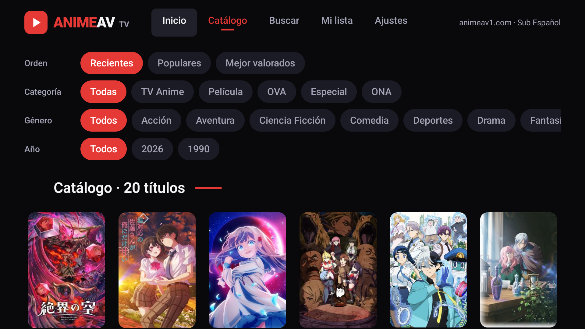 | 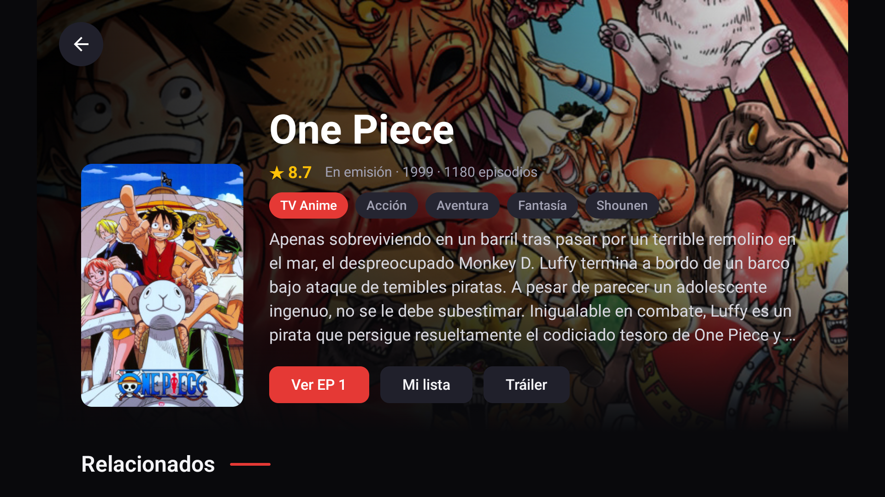 |

| Reproductor nativo | Servidores | Búsqueda |
| --- | --- | --- |
| 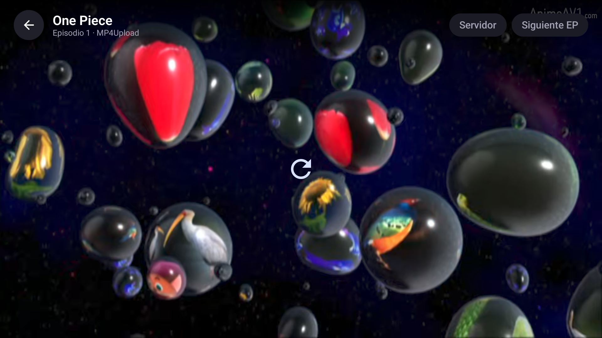 | 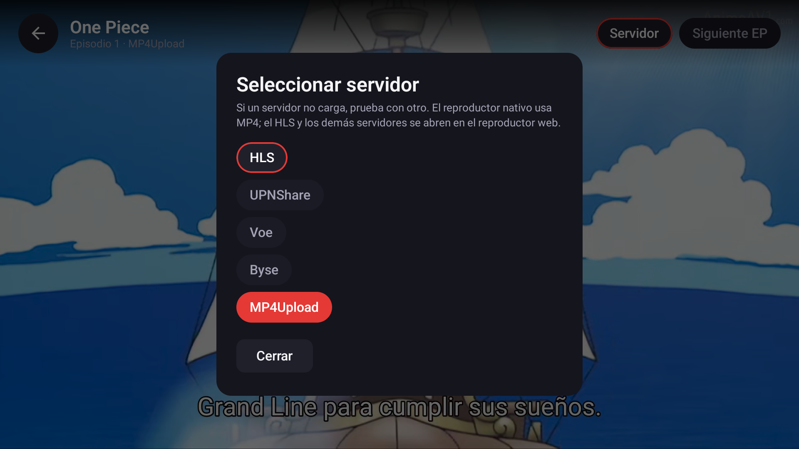 | 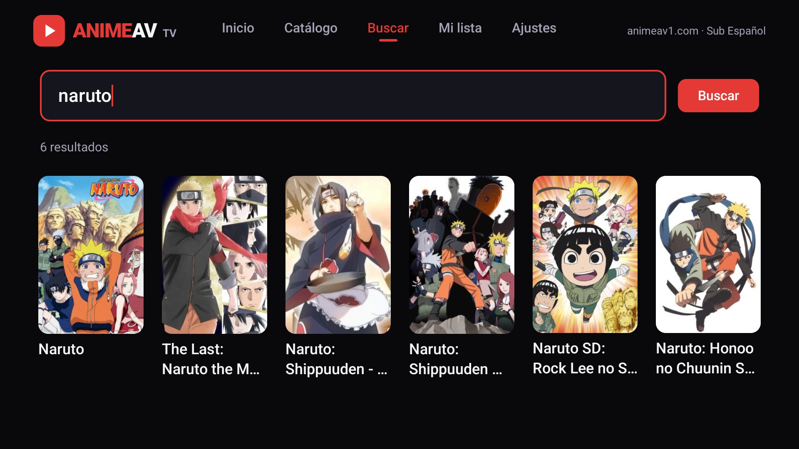 |

| Mi lista | Ajustes |
| --- | --- |
| 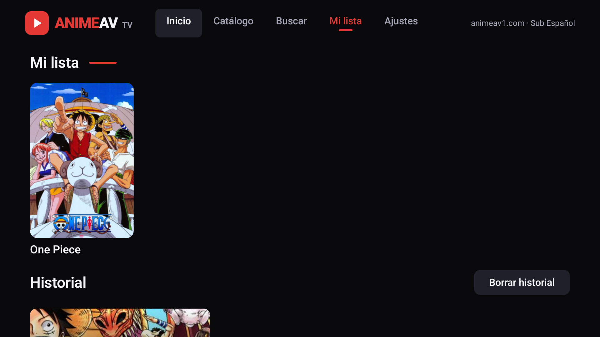 | 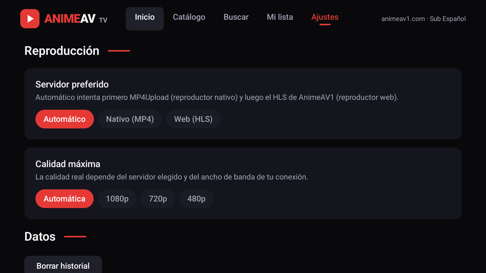 |

| Descargas | AniList |
| --- | --- |
| 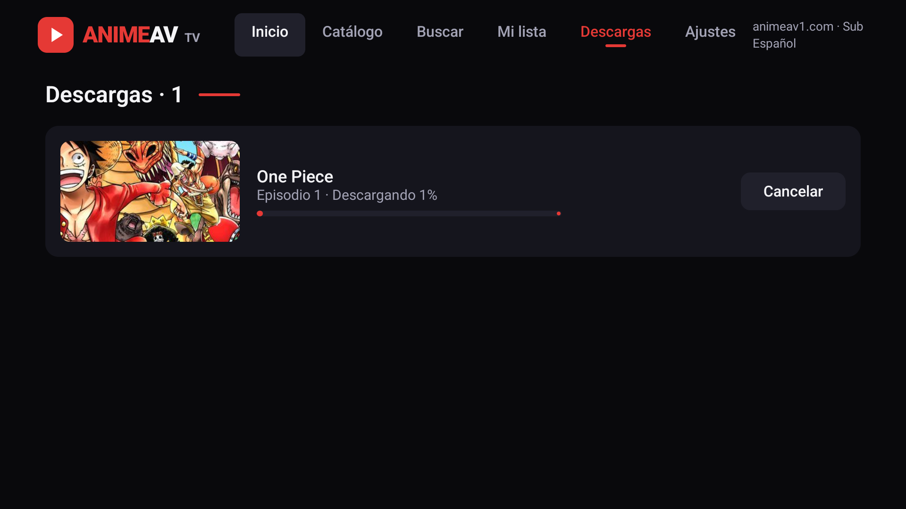 | 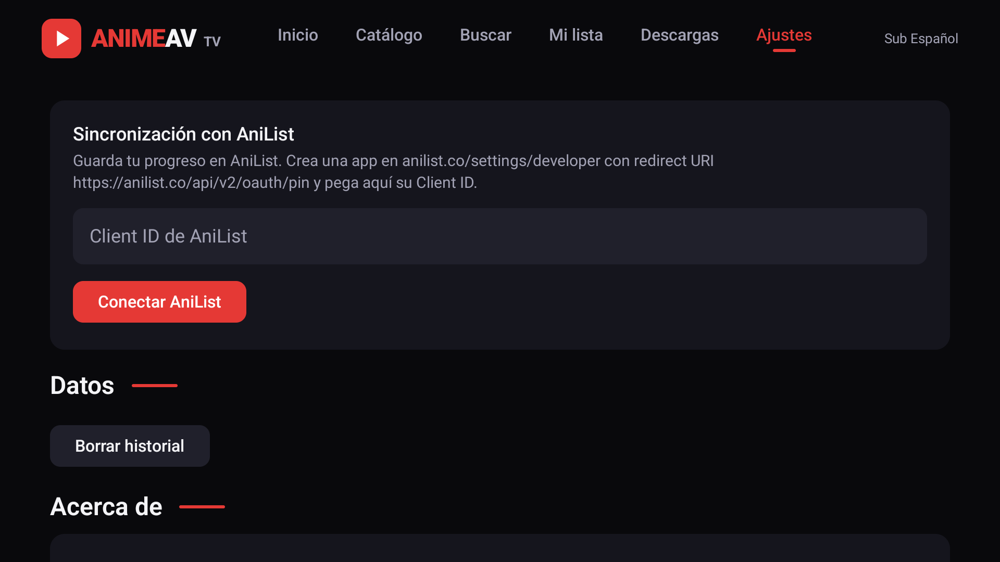 |

| Google TV real | Reproductor en TV |
| --- | --- |
| 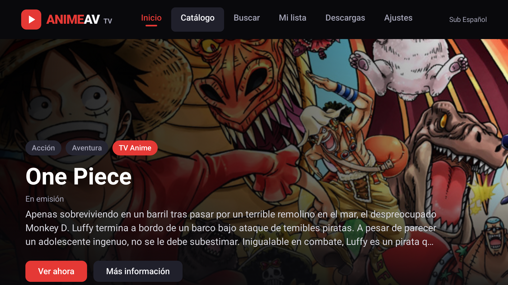 | 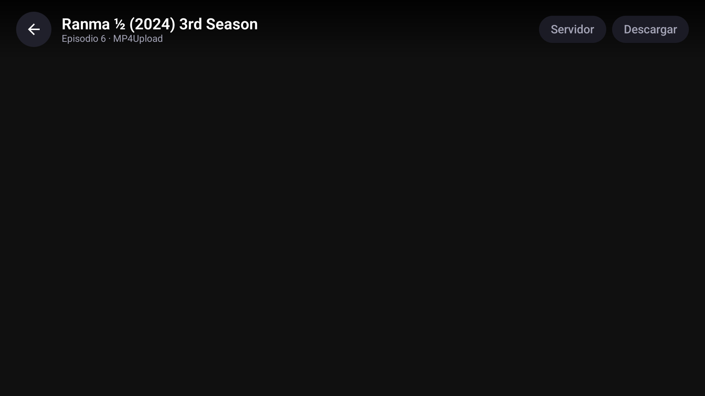 |

| Controles nativos | HLS nativo en TV |
| --- | --- |
| 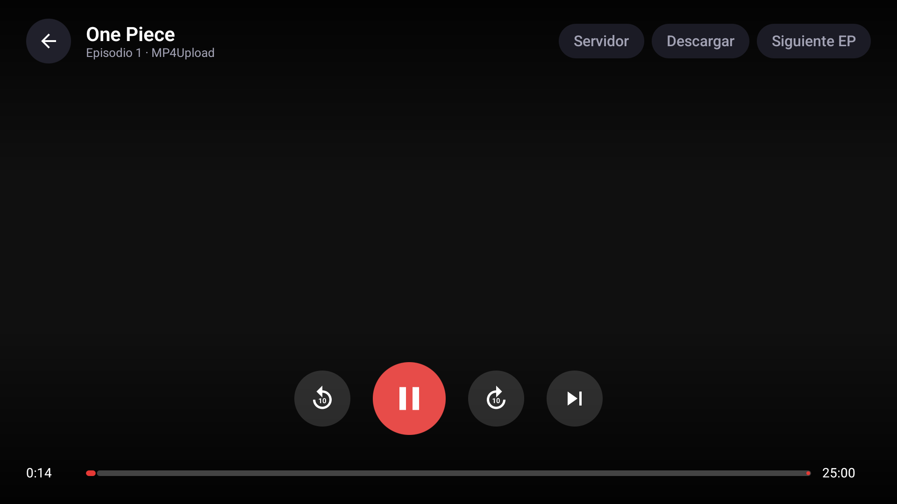 | 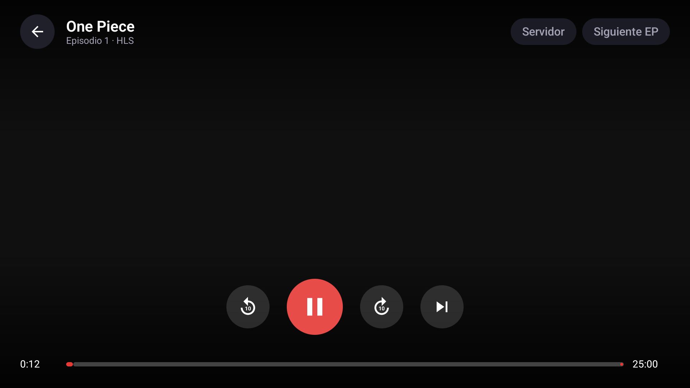 |

## Requisitos

- Android TV / Google TV con Android 5.1 (API 23) o superior.
- Conexión a Internet.
- Para compilar: JDK 21, Android SDK 35 y Gradle (el wrapper ya está incluido).

## Compilación

```bash
export JAVA_HOME="$HOME/Android/jdk-21.0.13+9"
export ANDROID_HOME="$HOME/Android/Sdk"
./gradlew :app:assembleDebug
```

El proyecto usa:

| Pieza | Versión |
| --- | --- |
| Android Gradle Plugin | 8.7.3 |
| Gradle | 8.11.1 |
| Kotlin | 2.1.0 |
| Compose BOM | 2025.01.00 |
| Media3 | 1.5.1 |
| Cronet embedded | 141.0.7340.3 |
| WorkManager | 2.10.0 |
| Coil | 2.7.0 |
| OkHttp | 4.12.0 |

## Instalación en el televisor

1. Activa **Opciones de desarrollador** y **Depuración ADB** en el televisor.
2. Conéctate por red:

   ```bash
   adb connect IP_DEL_TELEVISOR:5555
   adb install -r app/build/outputs/apk/debug/app-debug.apk
   ```

3. Abre **AnimeAV TV** desde la fila de aplicaciones de Android TV.

También puedes usar un USB o una app como *Send Files to TV*.

## Arquitectura

```
app/src/main/java/com/animeav/tv/
├── AnimeAvApp.kt              # Application, OkHttp, Coil, Cronet, repositorio y almacenamiento
├── MainActivity.kt            # Entrada Compose + NavHost
├── PlayerActivity.kt          # Reproductor nativo (ExoPlayer + Cronet)
├── WebPlayerActivity.kt       # Reproductor web (WebView + iframe)
├── LocalPlayerActivity.kt     # Reproductor de descargas locales
├── AniListAuthActivity.kt     # OAuth implícito de AniList en WebView
├── data/
│   ├── Devalue.kt             # Decodificador del payload SvelteKit (__data.json)
│   ├── Models.kt              # DTOs y modelos de dominio
│   ├── AnimeAvClient.kt       # Endpoints de animeav1.com
│   ├── AnimeRepository.kt     # Fachada de datos + enriquecimiento AniList
│   ├── AniListClient.kt       # GraphQL de AniList (metadatos y progreso)
│   ├── PlaybackResolver.kt    # Resolución de servidores (MP4Upload / HLS / web)
│   ├── LibraryStore.kt        # Historial y Mi lista (JSON local)
│   ├── DownloadsStore.kt      # Registro de descargas (JSON local)
│   └── SettingsStore.kt       # Preferencias y token de AniList
├── work/
│   ├── DownloadWorker.kt      # Descarga en segundo plano + notificación
│   └── DownloadScheduler.kt   # Encola/cancela trabajos de WorkManager
└── ui/
    ├── AppNav.kt
    ├── components/            # Top bar, tarjetas, chips, estados
    ├── screens/               # Home, catálogo, búsqueda, detalle, biblioteca,
    │                          # descargas, ajustes, player, WebPlayer, LocalPlayer
    ├── theme/
    └── vm/                    # ViewModels
```

### Flujo de datos

1. La app pide `https://animeav1.com/__data.json`, `/catalogo/__data.json`, `/media/{slug}/__data.json` o `/media/{slug}/{n}/__data.json`.
2. El cuerpo es un payload de SvelteKit con un array plano de referencias (formato *devalue*). `Devalue.kt` lo convierte en un árbol JSON normal.
3. Los DTOs de `Models.kt` se deserializan con kotlinx.serialization.
4. La ficha se enriquece con AniList usando el `malId`: carátula `extraLarge`, banner, géneros, puntuación y `anilistId`.
5. Para reproducir, se leen los `embeds` del episodio:
   - **MP4Upload** se resuelve a un MP4 progresivo y se reproduce con ExoPlayer.
   - **HLS / zilla** se intenta con ExoPlayer + Cronet; si Cloudflare devuelve 403, se abre el WebView automáticamente.
   - **Voe / Byse / UPNShare** se abren en el WebView.
6. El progreso se guarda cada 5 segundos en `files/library.json` y, si hay sesión de AniList, se sincroniza al salir del episodio.
7. Las descargas MP4 se gestionan con WorkManager y se registran en `files/downloads.json`.

## Endpoints utilizados

| Uso | Método | Ruta |
| --- | --- | --- |
| Inicio | GET | `/__data.json` |
| Catálogo | GET | `/catalogo/__data.json?page=N&genre=...&category=...&year=...&order=recent\|popular\|score` |
| Búsqueda | POST | `/api/search` con `{"query":"..."}` |
| Ficha | GET | `/media/{slug}/__data.json` |
| Episodio | GET | `/media/{slug}/{number}/__data.json` |
| HLS | GET | `https://player.zilla-networks.com/m3u8/{id}` |
| MP4 | GET | embed de MP4Upload, se extrae la URL `/d/.../video.mp4` |
| AniList | POST | `https://graphql.anilist.co` (metadatos y `SaveMediaListEntry`) |

Más detalle en [`docs/animeav1-endpoints.md`](docs/animeav1-endpoints.md).

## Descargas offline

- Abre un episodio en **MP4Upload** y pulsa “Descargar” en la barra del reproductor (TAB para llegar al botón).
- La descarga se ejecuta en segundo plano con **WorkManager** y muestra una notificación de progreso.
- En la pestaña **Descargas** puedes ver el progreso, cancelar, reproducir o eliminar el archivo.
- Los archivos se guardan en `files/downloads/` y se reproducen con el reproductor local (ExoPlayer).
- Las descargas de HLS no están soportadas en esta versión.

## AniList (opcional)

La app funciona sin cuenta. Si quieres sincronizar el progreso:

1. Crea una app en <https://anilist.co/settings/developer>.
2. Configura el redirect URI `https://anilist.co/api/v2/oauth/pin`.
3. En **Ajustes → AniList**, pega el Client ID y pulsa “Conectar AniList”.
4. Inicia sesión en el WebView. La app guarda el token y muestra el nombre de usuario.
5. Al salir de un episodio, se envía el progreso con `SaveMediaListEntry`.

El token se guarda solo en el dispositivo (`SharedPreferences`) y nunca se envía a AnimeAV1.

## Limitaciones conocidas

- El HLS de zilla está detrás de Cloudflare. La app lo reproduce de forma nativa con **ExoPlayer + Cronet y headers de navegador**; si el bloqueo cambia, cae automáticamente al WebView.
- Voe exige un token de sesión y un popup; se abre en WebView.
- Las descargas offline solo están disponibles para MP4Upload (MP4 progresivo).
- La sincronización con AniList requiere un Client ID propio; la app no incluye credenciales de terceros.
- La disponibilidad y la calidad dependen de los servidores de AnimeAV1.
- La app puede dejar de funcionar si AnimeAV1 cambia su API o su estructura de datos.

## Aviso legal

Este proyecto es un cliente no oficial, personal y educativo. **No aloja, transmite ni distribuye contenido audiovisual.** No está afiliado a AnimeAV1 ni a sus proveedores. Los nombres, imágenes y marcas pertenecen a sus respectivos titulares. El usuario es responsable de cumplir las leyes de su país y los términos de servicio de los sitios que utilice.
